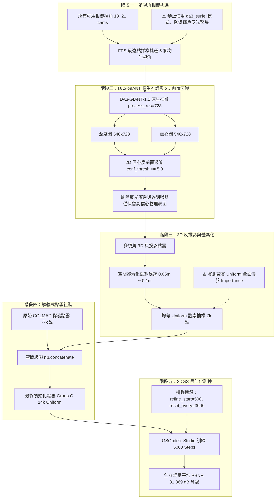

# DA3 + COLMAP 點雲最佳化與 3DGS 初始化管線完整開發指南 (Developer & AI Agent Guide)

> **版本**：v2.0 (Decoupled Architecture & 2D Confidence Filtered)  
> **更新日期**：2026-10-13  
> **路徑**：`scripts/README_DA3_COLMAP_PIPELINE.md`  
> **適用對象**：後續接手本專案之 AI Agent、研究人員與工程師。

---

## 目錄
1. [架構動機與核心機理 (Why Decoupled DA3 + COLMAP?)](#1-架構動機與核心機理)
2. [管線架構與流程圖 (Architecture Workflow)](#2-管線架構與流程圖)
3. [核心模組與程式碼職責 (File Structure & Roles)](#3-核心模組與程式碼職責)
4. [三大關鍵技術突破 (Key Technical Breakthroughs)](#4-三大關鍵技術突破)
5. [後續開發指南：哪些可以動？哪些絕對不能動？(Do's and Don'ts)](#5-後續開發指南哪些可以動哪些絕對不能動)
6. [黃金配置與實戰指令 (Golden Configurations & Quickstart)](#6-黃金配置與實戰指令)

---

## 1. 架構動機與核心機理

### 1.1 傳統方法的痛點
- **純 COLMAP (~7k 點)**：
  - **優點**：由多視角光束法平差（Bundle Adjustment）求出，剛性幾何真值極為精確。
  - **缺點**：在無紋理區域（平坦桌面、白牆、食材表面）特徵點極度稀疏。3DGS 在訓練初期缺乏幾何骨架，必須依賴緩慢的梯度分裂繁殖（densification），容易在平坦區域產生懸浮浮空（floater）或針狀拉伸偽影。
- **純單眼深度 DA3 (如舊版 50k / 7.3k)**：
  - **優點**：單幀神經網路推論提供密集表面幾何，在實體漫反射食材（菠菜、牛肉、牛排）起步飛快（Step 500 領先 COLMAP +4.3 dB）。
  - **缺點**：單眼模型對**鏡面高光、透明液體與玻璃杯（如 Coffee Martini）**具有固有的物理深度預測偏差。若無多視角剛性幾何錨點約束，3DGS 在訓練中期（Step 1500）就會被鎖定在錯誤幾何上，PSNR 永久停滯在 ~25.8 dB。

### 1.2 我們的核心解法：解耦式空間腳手架 (Decoupled Spatial Scaffolding)
我們提出 **Decoupled（解耦融合）** 架構：
1. **COLMAP 稀疏點（~7k 點）100% 原樣保留**：作為空間的剛性幾何真值錨點（Fixed Anchors），不參與任何體素化平均或法向量粗化。
2. **DA3-GIANT 點雲作為空間腳手架（Spatial Scaffolding）**：經由 2D 信心度高門檻去噪後，在體素空間執行均勻取樣，為平坦與低紋理表面鋪設平滑初始點。
3. **成果**：在實體場景（Sear Steak）衝上 **34.13 dB**；在鏡面反光場景（Coffee Martini）穩定維持 **27.40 dB**（遠甩純 DA3 +1.54 dB）。

---

## 2. 管線架構與流程圖



---

## 3. 核心模組與程式碼職責

| 檔案路徑 | 模組定位 | 核心職責 |
| :--- | :--- | :--- |
| `mvtracker/utils/camera_selection.py` | 核心視角挑選 | 實作 `select_cams_by_fps`（外參最遠點採樣）與光軸均勻角計算。 |
| `scripts/generate_uniform_da3_pcds.py` | 核心點雲生成器 | DA3-GIANT 推論、動態層卸載（Layer Offload）、2D 信心濾波、Decoupled 解耦組裝。 |
| `scripts/optimize_spatial_weights_3dgs.py` | 核心特徵優化器 | 5 項特徵（Sobel, DCT, Chroma, Base, Colmap）SLSQP 凸優化求解器與 KL 散度評估。 |
| `scripts/generate_all_6scenes_6frames_da3_pcds.sh` | 生產管線入口 | 封裝標準參數，一鍵批次生成全量 6 場景 × 6 關鍵幀（共 36 影格）去噪點雲。 |
| `scripts/legacy_experiments/evaluate_6scenes_matrix_ablation.py` | 評估彙整工具 | 讀取全量 144+ 組 3DGS 訓練 checkpoints，計算 PSNR / SSIM / LPIPS / GS 數量並輸出分群報表。 |
| `scripts/legacy_experiments/plot_psnr_step_curves.py` | 論文繪圖工具 | 提取 Step 500 ~ 5000 驗證點，繪製出版級 300 DPI 雙欄收斂折線圖與 JSON 數據。 |
| `scripts/legacy_experiments/run_6scenes_matrix_ablation.sh` | 矩陣訓練排程 | 144 runs 訓練腳本（具備斷點秒速續跑防重複訓練機制）。 |

---

## 4. 三大關鍵技術突破

### 突破 1：FPS 視角採樣 vs. 舊版 Surfel 權重採樣
- **現象**：舊版 `select_cams_by_da3_surfel` 依據表面微基元數量與法向量多樣性評分，在 `coffee_martini` 場景中，左側窗戶的反光與透視劇烈變化導致該區域評分虛高，相機挑選演算法被「吸引」過度採樣窗戶視角，反投影出滿天窗外飛點。
- **解法**：改用純外參空間之 **FPS (`select_cams_by_fps`)**，強制在 18~21 個視角中均勻散佈挑選 5 個主相機，保證視角覆蓋最大立體角，同時對窗戶噪點具備天然免疫力。

### 突破 2：2D 前置信心度過濾（$\ge 5.0$）vs. 3D 事後濾波
- **現象**：若反投影出 3D 點後才依體素信心度過濾，光線反投影過程中產生的虛假深度已污染了體素網格的包圍盒（Bounding Box）與特徵統計。
- **解法**：在 2D 像素層面即套用 `valid_mask = (conf >= 5.0)`。凡信心低於門檻之高光或透明像素，**直接不生成 3D 射線**，從源頭根除飛點。

### 突破 3：Uniform 採樣全面碾壓 Importance 採樣（全場景第一名）
- **實驗事實**：
  - **Group C: 14k Uniform (7k COL + 7k DA3 Uni)**：全場景總平均 **31.369 dB**，LPIPS **0.0918**（**全場冠軍**）。
  - **Group B: 14k Importance (7k COL + 7k DA3 Imp)**：總平均 30.821 dB，LPIPS 0.0934。
- **物理機理**：
  - Importance 依據 Sobel/DCT/Chroma 高頻特徵抽樣，導致新點 100% 堆積在高頻邊界，平坦區域（桌面、背景）完全沒有分到點；且邊界點過度密集引發 3DGS 劇烈梯度競爭與過早分裂。
  - **Uniform 體素採樣**在保留 COLMAP 邊緣特徵點的基礎上，均勻為所有可見表面提供均質的幾何厚度，提供了最完美的空間腳手架。

---

## 5. 後續開發指南：哪些可以動？哪些絕對不能動？

> [!CAUTION]
> ### ❌ 絕對不能動的五大紅線 (DO NOT TOUCH)
>
> 1. **絕對不要改回 `cam_select_mode da3_surfel`**：
>    - 必須嚴格保持 `--cam_select_mode fps`。改回 surfel 會再次誘發窗戶反光群聚與滿天飛點。
> 2. **絕對不要使用 `colmap_strategy coupled`**：
>    - 必須嚴格保持 `--colmap_strategy decoupled`。不要讓 COLMAP 點在體素內與單眼 DA3 點做平均或法向量融合，這會稀釋掉 SfM 的毫米級精確坐標。
> 3. **絕對不要將 2D 信心門檻降至 2.5 以下**：
>    - 必須保持 `--conf_filter_mode 2d --conf_thresh 5.0`。門檻設為 2.5 會放行窗外虛假深度與桌面透明液體噪點。
> 4. **絕對不要對深度/信心圖進行雙線性插值 (Bilinear Interpolation)**：
>    - 必須採用 `--process_res 728` 原生比例推論，或僅使用 `mode="nearest"` 對齊。雙線性插值會在前景物體邊緣產生非物理的「黏滯漸層深度」。
> 5. **絕對不要隨意開啟 `--export_full` 或向磁碟儲存 `.npz` 快取**：
>    - `da3_full.ply` 單檔超過 16MB，全場景全影格會佔用數十 GB 空間。管線遵循**零磁碟快取原則**，記憶體即時採樣後直接寫入最終 target ply。

---

> [!TIP]
> ### ✅ 可以安全探索與改進的方向 (Safe to Explore)
>
> 1. **點數預算探索**：
>    - 目前 14k（7k COL + 7k DA3）為最優。可微調為 10k（7k COL + 3k DA3）或 20k（7k COL + 13k DA3）尋找邊界效應。
> 2. **動態體素尺寸 (`min_voxel_size`)**：
>    - 目前預設為 `0.05m` ~ `0.10m`。若處理更大場景或微型微距場景，可調整該參數。
> 3. **4D 動態連續幀擴展**：
>    - 本架構之 `fps` + `decoupled uniform` 原理完全適用於動態 4DGS（如 Rigs 資料集）之各幀初始化。
> 4. **下游渲染損失函數**：
>    - 目前訓練端為標準 3DGS L1 + D-SSIM。可探索加入平滑法向量正則化（Normal Consistency）。

---

## 6. 黃金配置與實戰指令

### 6.1 生成全量 6 場景 × 6 關鍵幀（共 36 影格）最佳點雲
執行預設腳本（自動啟用 Docker 環境與最優參數）：
```bash
cd /home/tsaichenghan/mvtracker
./scripts/generate_all_6scenes_6frames_da3_pcds.sh
```

### 6.2 單一場景 / 指定影格手動生成指令
若僅需測試特定場景（如 `sear_steak` 幀 25）：
```bash
docker compose run --user $(id -u):$(id -g) --rm mvtracker python3 scripts/generate_uniform_da3_pcds.py \
  --scenes sear_steak \
  --frames 25 \
  --budgets 14000 \
  --cam_select_mode fps \
  --process_res 728 \
  --da3_model depth-anything/DA3-GIANT-1.1 \
  --conf_thresh 5.0 \
  --conf_filter_mode 2d \
  --colmap_strategy decoupled \
  --overwrite
```
**生成檔案說明**：
- `da3_giant_colmap_uniform_14k.ply`：**Group C 黃金配置 (7k COLMAP + 7k DA3 Uniform)**
- `da3_giant_colmap_importance_14k.ply`：Group B 配置 (7k COLMAP + 7k DA3 Importance)

### 6.3 3DGS 訓練最佳化黃金指令 (GSCodec_Studio 側)
在啟動 3DGS 訓練時，務必帶入以下參數：
```bash
docker compose run --rm -it gsc_studio python3 examples/simple_trainer.py \
  default \
  --eval_steps 500 1000 1500 2000 2500 3000 3500 4000 4500 5000 \
  --disable_viewer \
  --data_factor 2 \
  --refine_start_iter 500 \
  --reset_every 3000 \
  --max_steps 5000 \
  --data_dir datasets/sear_steak/colmap_25 \
  --init_ply datasets/sear_steak/colmap_25/da3_giant_colmap_uniform_14k.ply \
  --result_dir results/144exp/sear_steak/f25_3dgs_giant_colmap_14k_uni_refine500_reset3000
```

### 6.4 評估與折線圖繪製
- **全量矩陣指標評估**：
  ```bash
  python3 scripts/legacy_experiments/evaluate_6scenes_matrix_ablation.py
  ```
- **繪製收斂折線圖**：
  ```bash
  python3 scripts/legacy_experiments/plot_psnr_step_curves.py
  ```
  輸出高解析度圖檔於 `/media/tsaichenghan/2TBSSD/results/psnr_vs_step_comparison_2panel.png`。
